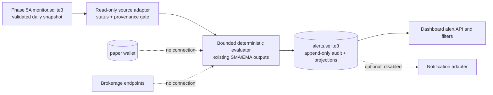
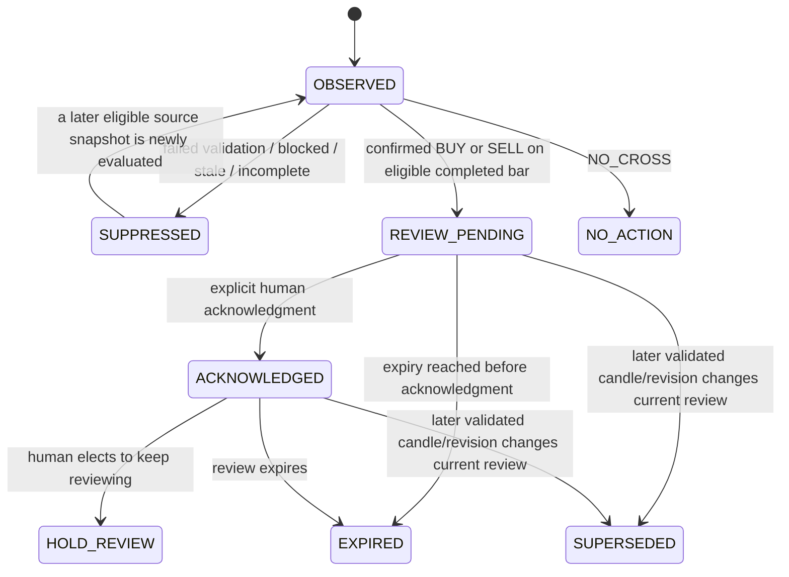

# Dual MA AI Phase 5B Design: Operational Intelligence and Alerts

**Status:** Phase 5B.1 implemented and validated in isolation; not activated, committed, or published.
**Base:** accepted Phase 5A commit `1565a14e602de4545c2797a2f5530dda5e79350f`.
**Implementation branch:** `feature/dual-ma-ai-phase5b` in an isolated worktree.
**Operating mode:** Local-first, read-only, PAPER-only. This phase creates review alerts only. It has no portfolio, order, fill, or wallet authority.

## Architecture and current interfaces

Phase 5A already calculates causal SMA/EMA crossover outputs from completed, validated daily bars. `dual_ma_ai.monitor` persists those daily snapshots, their provenance and informational signal rows in its separate `data/dual_ma_ai/monitor/monitor.sqlite3`. The dashboard reads monitor health through a lightweight snapshot path and isolates research work from `/api/monitor`. The wallet is a separate application and is not part of the monitor worker's dependency graph.

Phase 5B should consume the persisted monitor snapshot through a read-only adapter. It should not recalculate moving averages, request Alpaca data, mutate monitor state, change the strategy engine, or modify the wallet. A separate alert database and evaluator isolate audit writes and processing from the market worker and wallet. The dashboard gains a bounded, read-only alert view backed by this database; monitor health remains served by its existing fast path.

### Threat and failure-mode review

| Threat or failure | Required response |
|---|---|
| BLOCKED, STALE, unavailable, incomplete, invalid or insufficiently covered ticker data | Do not create an actionable review alert. Append a suppression audit record with reason and source observation identity. Retain any prior validated alert, but mark it non-actionable/stale as appropriate. |
| In-progress refresh, partially published snapshot, or worker restart | Read only committed snapshots; require `in_progress=false`, healthy completion metadata, and a validated per-ticker row. Never infer success from process existence or quote freshness. |
| Duplicate polling, replay, retries, process restart, or concurrent evaluator | Stable logical keys, database uniqueness, one evaluator lock, bounded admission, and transactional insert-or-ignore. Same input replay must yield the same current projection and audit event IDs. |
| Corrected/revised data for an already seen candle | Preserve the original observation and audit trail. Validate the new content hash. If its decision changes, append a supersession/suppression transition and a new revision; never rewrite past audit rows. |
| Stale alert displayed after a market closure or sleep/wake | Derive eligibility and expiry using the existing NYSE calendar. Closures do not create candles or extend an alert indefinitely. Recheck expiry at presentation and before acknowledgment. |
| Clock skew, timezone confusion, future timestamps | Require timezone-aware UTC timestamps, compare source timestamps with bounded skew, and use the NYSE session calendar for session/candle boundaries. Invalid time metadata fails closed. |
| Slow evaluator or alert database lock | Separate database, short transactions, WAL/busy timeout, bounded queue and request deadlines. Never make `/api/monitor` wait on alert or notification work. Return explicit capacity errors on the alert endpoint. |
| Notification outage, duplicate send, or provider throttling | Notifications remain disabled by default. If enabled later, use an idempotent outbox, bounded retry schedule, per-destination circuit breaker, and no effect on signal eligibility or dashboard/monitor availability. |
| Secret exposure or unsafe destination | Load optional credentials from OS Keychain/environment at runtime; redact errors; allowlist HTTPS destinations and reject redirects. No secrets in source, SQLite event payloads, dashboard responses, or logs. |
| Dashboard cross-site scripting or acknowledgment abuse | Escape all signal/provider text; serve only loopback, same-origin API; validate request sizes, CSRF/origin and idempotency key; require explicit human acknowledgment with recorded local actor identity. |
| Audit alteration or disk loss | Append-only triggers, deterministic row hashes/chain verification, integrity checks and a documented backup/export procedure. SQLite hash chaining detects edits; it does not replace off-machine backups. |
| Accidental trade/wallet coupling | Keep alert modules free of wallet, broker/order and portfolio imports. Add import-boundary tests and assert no trading endpoint or transaction route is added. |

## Event and alert state-machine specification

### Data contract and decision gate

The source adapter accepts only the latest committed daily row when all of these conditions hold:

1. The monitor snapshot is readable, `in_progress` is false, and its latest refresh completed successfully enough to validate this symbol.
2. The ticker row is `VALIDATED`; the feed is the authorized feed recorded by the source (currently IEX); its source, adjustment policy, validation result, data hash, candle date, `closed_at`, `usable_at`, and `fetched_at` are present and timezone-valid.
3. The candle is a completed NYSE session candle, is the expected latest session under the existing calendar, meets the existing warmup/history coverage requirements, and is within the configured freshness bound.
4. The signal is one of the existing strategy outputs for that exact candle. No signal is inferred from current quotes, incomplete bars, or a regime without a crossover.

Any failed gate results in `SUPPRESSED` with a machine-readable reason and human explanation, not an actionable alert. A missing ticker can be audited as a suppression observation but cannot become `ENTRY_REVIEW` or `EXIT_REVIEW`. When a source row is stale after prior validation, the prior alert remains in the audit history and the current projection becomes non-actionable.

### Identity and deterministic replay

Use canonical UTF-8 JSON with sorted keys and fixed decimal/string timestamp formats before SHA-256 hashing. The logical crossover key is:

`(ticker, strategy_id, strategy_rule_version, source, feed, adjustment_policy, candle_date, side)`.

Its stable `signal_id` is the SHA-256 of that tuple. Do not include wall-clock evaluation time or process ID. Store the observed payload hash separately. A replay of identical input produces identical signal/event IDs. A changed payload hash for the same logical key is a revision observation: append a revision event, revalidate, and supersede or suppress the prior projection as needed. Unique constraints prevent two current actionable rows for the same logical key.

Audit event IDs are deterministic from `(signal_id, transition, transition_version, source_payload_hash, idempotency_key)`. Repeated attempts to append the same transition are idempotent. A database sequence is not an event identity.

### Technical signal and human decision separation

Persist the technical result (`BUY`, `SELL`, `NO_CROSS`) independently from the human review state:

- `BUY` maps to `ENTRY_REVIEW`.
- `SELL` maps to `EXIT_REVIEW`.
- A still-open, unexpired review after acknowledgment maps to `HOLD_REVIEW` only when a human explicitly selects/acknowledges “continue review”; the system does not infer a holding or brokerage position.
- `NO_CROSS`, a failed eligibility gate, or a closed/expired signal maps to `NO_ACTION`.

These are informational review classifications. They never place an order, create a paper position, size shares, mutate wallet balances, or imply that an investor owns a security.

### Lifecycle

`OBSERVED`, `SUPPRESSED`, `CREATED`, `VALIDATED`, `ACKNOWLEDGED`, `EXPIRED`, and `SUPERSEDED` are append-only audit transitions; current state is a replaceable projection that can be rebuilt from the event log. An acknowledgment requires a bounded request body and an idempotency key. Repeated acknowledgment with the same key returns the original outcome; a conflicting key/state is rejected and audited. No silent dismissal is allowed: dismissal is an explicit acknowledgment outcome.

### Expiration

Expiration is policy-driven by `(strategy_id, timeframe)`. Persist the selected policy ID/version, timeframe, session count or bar limit, resulting deadline, and calendar identifier/version when creating an alert. A later policy change must not silently rewrite an existing deadline. Session-based expiration counts eligible exchange sessions from the signal candle; weekends and holidays do not count. Early closes and daylight-saving transitions use the existing NYSE calendar.

For 5B.1, only the existing **daily** monitor outputs are supported. Each existing daily strategy initially expires at the close of the next eligible regular NYSE session after its signal candle. This is a daily default, not a universal rule. There is no intraday signal ingestion in 5B.1, and unsupported timeframes fail closed rather than inheriting the daily policy. A later intraday policy must define its own strategy/timeframe TTL (such as a configured number of regular-session bars and session-boundary behavior) and pass dedicated tests before intraday alerts are enabled. A new completed validated candle for the same ticker/strategy supersedes an older actionable projection sooner. On wake/restart, overdue alerts are expired in a bounded recovery batch before presentation. Dashboard reads independently suppress an expired row if the evaluator has not caught up.

## Data schema and migration plan

Use a new `data/dual_ma_ai/alerts/alerts.sqlite3`; do not add alert tables to the persistent wallet DB or mutate the Phase 5A monitor schema. Place DDL in a new Phase 5B schema/migration module. Use `PRAGMA user_version` and one exclusive migration transaction; reject newer or unknown schemas. Back up the alert DB before upgrades. A clean install starts with schema version 1. Migration never opens the wallet DB for writing.

Proposed version 1 tables:

| Table | Important columns and constraints |
|---|---|
| `audit_events` | `event_id TEXT PRIMARY KEY`, `signal_id`, `event_type`, `at_utc`, `source_snapshot_id`, `payload_hash`, canonical `payload_json`, `previous_hash`, `event_hash`; append-only update/delete triggers. `event_hash = SHA256(previous_hash || canonical_event_bytes)`. |
| `signals` | Materialized current projection keyed by `signal_id`: ticker, strategy/version, candle date, side, decision state, validation state/reason, provenance, payload hash, created/updated times, expiry, acknowledgment metadata, `actionable` boolean. Unique logical key and indexes on state, ticker, expiry, and newest event. |
| `observations` | Unique `(source_snapshot_id, ticker, strategy_id, candle_date, payload_hash)`; records validation/suppression/replay result, avoiding repeated source polling from creating unbounded duplicate events. |
| `idempotency` | `key PRIMARY KEY`, operation, canonical request hash, response/event ID and created time; acknowledgment retries resolve to the original result. |
| `notification_outbox` | Optional future adapter only: deterministic message ID, signal/event ID, destination profile ID (never secret), payload template version, state, bounded attempt count, `next_attempt_at`, safe last error category. Disabled/empty by default. |
| `service_state` | Evaluator heartbeat, last source sequence/hash, bounded failure counters, circuit state and next eligible retry. Not a substitute for successful validation. |

Immutable audit triggers apply only to `audit_events`; mutable projections are derived state and may be rebuilt. Validate the hash chain at startup and periodically with bounded batches. A detected chain break marks alert service `DEGRADED`, emits a safe diagnostic, and prevents new actionable alerts until repaired from a verified backup/source replay. Do not rewrite audit rows to “fix” a broken chain.

## Processing, concurrency, and recovery policy

- Run an isolated evaluator that polls committed Phase 5A monitor snapshots. Reuse `strategy.signals_many` outputs already persisted by Phase 5A; never invoke the provider or a second moving-average implementation. Use one process lock and SQLite writer transaction per bounded batch.
- Bound each poll to at most the configured ticker × strategy set, with a bounded queue of one pending snapshot per source sequence. Coalesce duplicate sequence work. If admission is full, return/record `CAPACITY_SUPPRESSED`; do not queue unbounded work or claim the snapshot was processed.
- Source-validation failures are not retried as signal work until the source sequence/hash changes or a cooldown ends. Network recovery remains owned by the Phase 5A worker. Alert-database transient failures use at most five retries with exponential delays of 1, 2, 4, 8, and 16 seconds plus stable hash-derived jitter capped at 20%; persist attempt state and make every transition idempotent.
- Open a circuit after five consecutive alert-store/evaluator failures for 60 seconds; permit one half-open attempt. A successful atomic commit closes the circuit. Validation/schema/hash-chain errors are non-retryable and escalate to `DEGRADED` until operator review. `ERROR` means the evaluator cannot safely append/read its audit state. Never relabel a failed run as a successful heartbeat.
- Cooldown applies to optional notification dispatch only: one send per signal/destination during the review lifecycle, with a configurable minimum interval. It does not suppress the durable in-dashboard review event. Recovery sends only current, unexpired outbox items; it never replays expired notifications.
- Logs include safe stage, ticker, strategy, attempt, elapsed time, and status category. They must exclude credentials, request headers, raw provider bodies, and full private paths.
- Monitor and dashboard health remain responsive regardless of evaluator state. The alert API reads only indexed alert projection rows with a short database busy timeout and hard result cap. It never synchronously calculates research, validates coverage, sends notifications, or takes a monitor lock. If alert DB is unavailable, return explicit `503`/degraded alert-panel data without blocking `/api/monitor`.

## Optional notification policy

External notifications are disabled by default and are outside the initial implementation gate. Configuration contains only provider name, enabled flag, destination profile ID, timeout, retry/backoff and allowed hostname. Secrets are obtained at runtime through macOS Keychain or an explicitly configured environment variable; neither credentials nor destination secrets are written to the repository or alert DB. A dry-run mode renders a redacted payload without network access. If later enabled, HTTPS host allowlisting, certificate verification, redirect denial, request timeout, per-provider rate/concurrency limits, an idempotent outbox, and an operator-visible circuit status are mandatory. Notifications contain only ticker, strategy, candle date, decision classification, source/feed and dashboard link; no account data or wallet details.

## Dashboard proposal

Add an alert section with filters for ticker, strategy, decision state, technical side, validation/actionability, acknowledgment, and date range. Display candle date, detected time, feed/source, provenance/validation state, expiry, human explanation, and whether the alert is informational/actionable for review. Blocked/stale/suppressed/expired events are visibly distinct and never styled as BUY/SELL recommendations. Add explicit acknowledge and “continue review” actions only after CSRF, origin, request-size, idempotency, and audit behavior pass review. Keep monitor panel polling and route execution isolated from alert DB and heavy reports. The dashboard must clearly say “READ ONLY — no trades or orders.”

## 5B.1 implementation scope

5B.1 is the first dashboard-only alert release. It consumes the already-persisted daily monitor outputs and never changes how Phase 5A computes or labels crossovers. It implements four advisory human states (`ENTRY_REVIEW`, `EXIT_REVIEW`, `HOLD_REVIEW`, `NO_ACTION`); none is an execution instruction. `HOLD_REVIEW` requires an explicit human choice to continue review and never implies an owned position. Suppressed and expired records retain `NO_ACTION` as their human state plus a distinct validation/lifecycle status and durable reason.

The first implementation supports only the three existing modern daily presets. It emits no LEGACY or intraday alerts. A validated local JSON policy file (path supplied by CLI/environment, with checked-in non-secret defaults) keys expiry by strategy and timeframe and specifies a policy version and session TTL. Each daily strategy initially defaults to one next eligible NYSE session close. Missing, invalid, or unsupported policy entries fail closed. Future intraday strategies require their own explicit policy and session-boundary tests before support. External notification transports, credentials, outbox processing, and enablement are explicitly out of 5B.1; notifications remain disabled.

### Implemented file changes

Phase 5B changes are isolated to the following files. Phase 5A strategy, monitor, market-data, wallet, and schema implementation files are unchanged.

| Action | File | Responsibility |
|---|---|---|
| Create | `dual_ma_ai/alert_schema.sql`, `dual_ma_ai/alert_store.py` | Versioned isolated alert DDL, deterministic IDs, append-only hash-chained audit, projections, idempotency, bounded reads. |
| Create | `dual_ma_ai/alert_policy.py`, `dual_ma_ai/alert_policy_defaults.json` | Per-strategy/timeframe validation and configured NYSE-session expiry. |
| Create | `dual_ma_ai/alert_evaluator.py` | Read-only monitor snapshot validation, advisory mapping, suppressions, dedup/revision and bounded recovery; no MA calculations or Alpaca requests. |
| Create | `dual_ma_ai/alert_worker.py` | Explicit foreground evaluator only; no LaunchAgent integration or automatic startup. |
| Modify | `dual_ma_ai/dashboard.py` | Bounded alert-list and local acknowledgment endpoints backed only by alert DB; existing `/api/monitor` path unchanged. |
| Modify | `dual_ma_ai/static/index.html`, `dual_ma_ai/static/app.js`, `dual_ma_ai/static/style.css` | Alert panel, filters, safe rendering, 10-second polling, explicit advisory acknowledgments and neutral state styles. |
| Create | `tests/test_alert_store.py`, `tests/test_alert_policy.py`, `tests/test_alert_evaluator.py`, `tests/test_alert_dashboard.py` | Store integrity, session expiry, event validation/replay/recovery, dashboard security and isolated concurrency tests. |
| Create | `tests/alert_helpers.py`, `tests/alert_dashboard_fixture.py`, `tests/dashboard_browser_alerts.cjs` | Reusable synthetic inputs and temporary localhost browser service. |
| Modify | `tests/dashboard_browser.cjs`, `tests/dashboard_health_fixture.py`, `tests/dashboard_health_replay_fixture.py`, `tests/dashboard_latency_browser_fixture.py`, `tests/monitor_browser_server.py` | Initialize temporary alert stores and isolate unrelated research responses so Phase 5A browser tests exercise their intended UI paths without `/api/alerts` setup errors or cold research work. |
| Modify | `docs/dual-ma-ai-phase5b-design.md` | This as-built architecture, test, and limitation record. |

No dependencies were added. LaunchAgent templates and installed services were not modified. The evaluator remains explicitly invoked and is not automatically scheduled. The persistent wallet, monitor DB, Phase 4.1 history/cache, LEGACY source/data, Turtle Mini, and BHAP are outside the application change set.

## Regression and acceptance test plan

Tests use temporary monitor/alert databases, fake clocks, deterministic synthetic bars, and mocked provider metadata. They never open or mutate `data/dual_ma_ai/wallet.sqlite3`, require live Alpaca credentials, contact notification providers, or modify LaunchAgents.

| Gate | Test and pass condition |
|---|---|
| Four advisory states | BUY→`ENTRY_REVIEW`, SELL→`EXIT_REVIEW`, explicit human continue-review→`HOLD_REVIEW`, and no cross/suppressed/expired→`NO_ACTION`; no state can invoke trading or mutate a wallet. |
| Phase 5A preservation | Existing full Python/browser suites pass; frozen strategy output, provenance, monitor behavior and Phase 4.1 backtests compare byte-for-byte or by existing deterministic artifact checks. |
| Replay determinism | Replay an identical validated snapshot 100 times and after evaluator restart: same logical IDs/projection, no duplicate audit transitions. |
| Confirmed crossover | Known completed-bar SMA/EMA fixtures produce expected technical side and review state; same-day/incomplete/future bars produce none. |
| Data gate | BLOCKED, STALE, missing, malformed, split-policy mismatch, stale expected session, incomplete refresh and insufficient history produce only suppression/no-action, never actionable review. |
| Feed/calendar/expiry | IEX remains selected where permitted; SIP remains unavailable unless source metadata explicitly permits it. Daily policies use NYSE sessions across holidays, early closes, DST and weekends. Strategies can have different TTLs. Unsupported intraday timeframe is rejected and never receives the daily default. |
| Dedup/revision | Duplicate events collapse; payload correction is audited and supersedes safely; changed side cannot leave two actionable current rows. |
| Lifecycle | Create, acknowledge, hold-review, expiration, supersession and suppression transitions are append-only, human explanations exist, and expired items cannot be acknowledged as current. |
| Audit integrity | Update/delete trigger rejection; hash-chain verification passes; tamper detection fails closed; projection rebuild from events is deterministic. |
| Restart/recovery | Crash before commit and after audit append; restart recovers idempotently without missing/duplicate lifecycle events. Notification/outbox behavior is out of scope. |
| Bounded work | Repeated identical inputs coalesce; queue saturation returns explicit capacity outcome; failure retries stop at configured bound; circuit open/half-open/recovery sequence is deterministic. |
| Concurrent load | Drive 48 `/api/monitor` GETs with four alert-list requests in the Python integration test; separately run the Phase 5A multi-page monitor browser probe. `/api/monitor` p95 < 2,000 ms, max < 5,000 ms; no event loss/duplication or blocked-symbol actionability. |
| Browser | Render/filter each state, initial loading/error/empty states, polling freshness, acknowledgment duplicate-submit protection, no page reload, and no console/network errors. Verify actual request counts and elapsed time independently. |
| Security/isolation | Import-boundary test forbids wallet/broker modules in evaluator; HTTP integration test exposes no order route; response/log scan finds no secrets/private paths; notification code/configuration is absent and notifications remain disabled. |
| Protected artifacts | Before/after SHA-256 and SQLite integrity checks confirm wallet balance USD 2,100, zero trading P&L, unchanged wallet audit history, and all 254 protected baselines unchanged. Turtle Mini/BHAP tree hashes remain unchanged. |

Initial implementation acceptance is local/isolated. No production service or LaunchAgent changes are in scope without a later explicit activation request. The monitor latency target is tested under alert load in temporary services before any deployment proposal.

## Validation results and remaining limitations

The complete Python regression command, `.venv/bin/python -m unittest discover -s tests -v`, passed **230 tests**. The 28 Phase 5B focused tests passed, covering deterministic IDs and replay/restart, all session policy cases, suppression including missing adjustment provenance, stale/blocked/incomplete data, acknowledgment idempotency, audit immutability/hash integrity, worker admission/recovery, endpoint security, wallet isolation, and concurrent reads. The legacy suite emitted non-fatal `ResourceWarning`s for SQLite connections; there were no test failures.

All seven isolated browser suites passed using temporary localhost services and temporary stores: dashboard/wallet flow, mocked Alpaca provenance, delayed-wallet DEGRADED rendering, DEGRADED replay/blocked ticker suppression, concurrent monitor polling, existing monitor UI, and Phase 5B alert UI. Browser checks recorded no JavaScript or network errors; the alert suite used one page navigation, two monitor polls and six alert polls, and verified a recorded advisory `HOLD_REVIEW` with no wallet change. The temporary fixtures now initialize an empty alert store and stub research endpoints that are outside the scenario under test.

The 48-monitor-plus-four-alert request test measured **p95 36.08 ms, maximum 37.29 ms** in the final full-suite run (52 concurrent localhost requests; 48 monitor samples). The fully synthetic two-page browser latency probe measured a direct `/api/monitor` response at **31 ms** and observed three monitor responses at 81, 13, and 31 ms. These are isolated regression measurements, not production LaunchAgent measurements.

Post-test integrity verification matched all **254/254** Phase 5A protected artifact hashes. The persistent wallet SHA-256 and audit-row hash matched the recorded baseline; SQLite `integrity_check` returned `ok`; wallet cents remained cash 210000, contributions 210000, realized trading P&L 0, with two existing audit events. The repository checkout at the accepted Phase 5A base has no tracked modifications from this work. The implementation is on the isolated Phase 5B branch/worktree. Turtle Mini and BHAP were not accessed or modified.

No dependencies were installed, no LaunchAgent was readied or changed, and no service was restarted. The implementation has not been activated. Phase 5B.1 supports only existing modern daily strategies; intraday policy ingestion, external notifications, automatic scheduling, and production operation remain out of scope. `alert_worker.py` is an explicitly invoked foreground tool and has no live service definition. The isolated temporary worktree must be reviewed before any later activation or Git publication.

## Original implementation effort estimate

| Work package | Scope | Estimate |
|---|---|---:|
| A. Schema and event log | Versioned separate DB, canonical serialization, deterministic IDs, append-only chain, projection rebuild | 1–2 engineer days |
| B. Eligibility/evaluator | Read-only monitor adapter, validation gates, four-state mapping, dedup/revision, configurable daily session expiry, bounded worker/recovery | 2–3 engineer days |
| C. Dashboard | Indexed alert API, filters/state rendering, explicit acknowledgment UX, failure/empty/loading paths | 1–2 engineer days |
| D. QA/security/acceptance | Deterministic fault injection, concurrency/browser, artifact/wallet isolation and review report | 2–3 engineer days |

**Total:** approximately 6–10 engineer days. External notifications, intraday signal support, LaunchAgent integration, and production activation are excluded.

Primary risks are SQLite writer contention if batches are too large, clock/calendar version drift affecting expiry, ambiguity when a provider revises an already validated candle, and increased schema/audit-operational burden. Mitigations are isolated storage, short indexed transactions, stored calendar/source versions, immutable revision events, and deterministic rebuild/integrity tests. The audit hash chain is tamper-evident only while its trusted head hash is preserved; it is not a cryptographic signature or backup.

## Decision reconciliation and next gate

This revision incorporates the design decision: retain all four advisory states; make expiry configurable per strategy/timeframe and count exchange sessions; use the next eligible session close only as each existing daily strategy's initial default; reject unsupported intraday input; implement dashboard-only alerts first with notifications disabled; consume validated Phase 5A outputs without changing their calculation or historical semantics; use stable IDs, uniqueness constraints, and transactional idempotency across restart/replay; audit every suppression reason; and isolate the alert SQLite store from monitor and wallet databases.

The implemented 5B.1 scope follows the approved decisions: four advisory states only; daily per-strategy/timeframe expiry based on NYSE sessions; dashboard-only presentation; unchanged Phase 5A strategy semantics; deterministic replay/deduplication; reasoned suppression; and a separate alert store. This is an isolated implementation candidate, not production acceptance. No commit, push, merge, wallet operation, LaunchAgent change, or activation has occurred.
